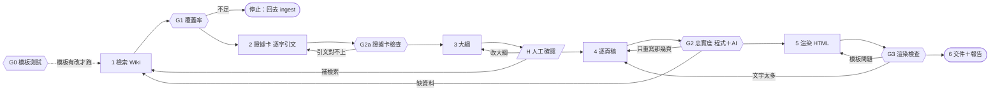

# SKILL：從 Wiki 產生教學 HTML 簡報（graph v2）

## 目標
- 輸入：一個主題＋讀者（例：「泰語五個聲調怎麼聽、怎麼念？」，讀者是完全沒學過泰語的同學）
- 輸出：`docs/slides/index.html`（8–15 頁、可用鍵盤翻頁），外加 `runs/<run-id>/` 裡的檢查報告
- **只能用 Wiki 的內容**。Wiki 沒有的，就不要放進簡報；資料不夠就停下來，回去 ingest。

## v2 改了什麼（依 run1 的結果）

| run1 發現的問題 | v2 的改法 |
|---|---|
| 最嚴重的錯在**證據卡**就發生了（摘要時把「活音節」這個條件丟掉），但到 G2 的 AI 審查才被抓到 | 證據卡改成**逐字引文**，並新增 **G2a 證據卡檢查**（程式）：引文必須一字不差出現在 Wiki；引用表格的一列時必須附上表頭 |
| 逐頁稿的數字、泰文只對整頁 Wiki 比對，太寬鬆 | G2 改成對「這一頁用到的證據卡」比對，每頁要列 `cards` |
| G3 的問題都是模板造成的，但 v1 只能退回節點 4 | G3 新增退回**節點 5** 的線：重疊、超出圖框、連結壞掉 → 修模板；文字溢出 → 回節點 4 |
| 渲染問題要到最後才發現，而且前兩輪程式都沒抓到 | 新增 **G0 模板測試**：改了模板就先用最難排版的假資料測，通過才開始寫稿；G3 程式加上「文字重疊」「超出圖框」檢查 |
| 「第 7 頁說明」的頁碼被當成事實數字 | 寫作規則：簡報內不用數字頁碼，改用頁名 |

## 節點與流程

| 節點 | 誰做 | 輸入 → 輸出 | 說明 |
|---|---|---|---|
| G0 模板測試 | 程式 `tools/template_test.py` | 假資料 → 通過／不過 | 只有改了 `render_slides.py` 才跑。不過就修模板 |
| 1 檢索 Wiki | AI | 主題 → `retrieval.json` | 先讀 `wiki/index.md`，列出學習目標，每個目標對應到哪幾頁 |
| G1 覆蓋率 | 程式 `tools/check_coverage.py` | → 通過／停止 | 每個目標至少 1 頁、總共至少 3 頁。**不足就停**，不准用 AI 自己的知識補 |
| 2 證據卡 | AI（每頁平行） | Wiki 頁 → `cards.json` | 每張卡 = 一段**逐字引文**（quote）；引用表格的一列要附表頭（context） |
| **G2a 證據卡檢查** | 程式 `tools/check_cards.py` | → 通過／退回 2 | 引文必須一字不差出現在 Wiki |
| 3 大綱 | AI | → `outline.md` | 8–15 頁；教學順序：引起動機 → 概念 → 例字 → 易錯 → 規則簡介 → 練習 → 總結 |
| H 人工確認 | 使用者 | → 同意／退回 | 退回時寫明「改大綱」或「補檢索」 |
| 4 逐頁稿 | AI | 大綱＋卡片 → `slides.json` | 每頁列 `cites`（Wiki 頁）和 `cards`（證據卡）；可以換句話說，但**條件和程度詞（微微、大約、只有…時）不能丟** |
| G2 忠實度 | 程式 `tools/check_slides.py`＋AI 審查 | → 報告 | 數字、泰文要出現在這頁用的證據卡裡；AI 審查用 `workflow/prompts/reviewer.md` |
| 5 渲染 | 程式 `tools/render_slides.py` | → `docs/slides/index.html` | 頁尾自動加出處連結 |
| G3 渲染檢查 | 程式 `tools/render_check.py`＋看截圖 | → 報告 | 溢出 → 退回 4；重疊、超出圖框、連結 → 退回 5 |
| 6 交件 | AI | → `report.md` | 列出每一輪抓到什麼、改了什麼 |

## 剎車
- **硬上限**：每個迴圈最多 3 輪。第 3 輪還不過，就交件並在報告寫明「未通過的項目」。
- **資料不足就停**：G1 不過時直接停止，回報缺哪個學習目標，建議 ingest 什麼資料。
- **每一輪只修報告列出的問題**，不准順手改別的頁。
- **花費**：記錄每個迴圈跑了幾輪；AI 審查只重看上一輪改過的頁。
